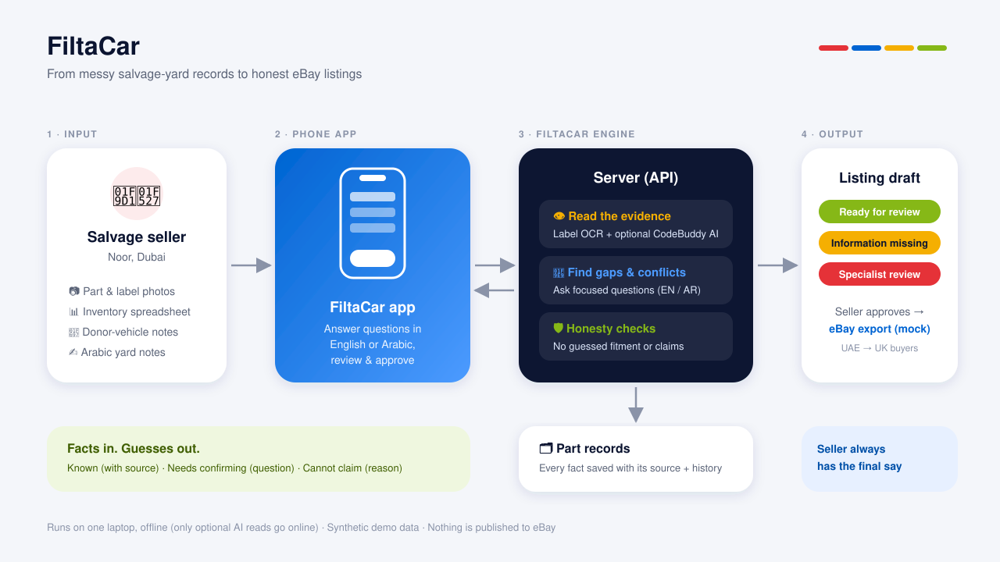

# FiltaCar



FiltaCar is an iPhone-style web app that helps a Dubai car-parts salvage seller turn messy inputs (label photos, inventory spreadsheets, donor-vehicle notes and Arabic yard notes) into honest eBay listing drafts for UK buyers.

Facts in. Guesses out. Every detail is either known (with its source), needs confirmation (with a question in English and Arabic), or cannot be claimed (with a reason). The seller always gives the final approval, and nothing is ever published: the eBay export is a mock file.

Built for the eBay case study "From Salvage Yard to Global Marketplace" at FutureMindz Fest (Dubai CommerCity). All demo data is synthetic.

## Contents

1. Requirements
2. Get the code
3. Install dependencies
4. Configure environment variables and settings
5. Run the app (development)
6. Build and run the app (production build)
7. Run the tests
8. Reset the demo data
9. Demo journeys
10. Optional: CodeBuddy AI second reader
11. Troubleshooting
12. Honesty rules
13. Project structure

## 1. Requirements

| Tool | Version | Needed for |
| --- | --- | --- |
| Node.js | 18 or newer (20 recommended) | Running the app and tests |
| npm | Comes with Node.js | Installing dependencies |
| Git | Any recent version | Getting the code |
| Google Chrome | Any recent version | Viewing the app; end-to-end tests |

Check your versions:

```sh
node -v
npm -v
git --version
```

No database, cloud account or internet connection is needed to run the app. Label reading (Tesseract) works offline with language files included in the repository.

## 2. Get the code

```sh
git clone https://github.com/parthbtw/MurdochDubai-FiltaCar.git
cd MurdochDubai-FiltaCar
```

## 3. Install dependencies

From the repository root, run once:

```sh
npm install
```

This installs both parts of the project (npm workspaces):

- client/: the React and TypeScript app (Vite)
- server/: the Express API, label reader and checks

## 4. Configure environment variables and settings

The app runs with no configuration. Every setting below is optional and has a working default.

### Server settings (file: server/.env)

Only needed for the optional CodeBuddy AI reader (section 10). To create the file:

```sh
cp server/.env.example server/.env
```

| Variable | Default | What it does |
| --- | --- | --- |
| CODEBUDDY_API_KEY | empty | Access key for the optional CodeBuddy AI second reader. Leave empty to run without it. |
| AI_LIVE_ENABLED | true in the example file | Set to true to allow new live AI readings, false to use saved readings only. Live readings also need the key and the CodeBuddy CLI. |

server/.env is ignored by Git. Never commit it or share your key.

### Process settings (set on the command line only when you need them)

| Variable | Default | What it does |
| --- | --- | --- |
| PORT | 3001 | Port the API listens on. |
| FILTA_DATA_DIR | data/ in the repository | Folder the API reads and writes records in. Point it at a copy to keep the demo data untouched. |
| FILTA_API_PORT | 3001 | Port the client sends /api, /uploads and /demo requests to (Vite proxy). Change it when PORT changes. |

Example: run the API on port 3101 using a temporary copy of the data:

```sh
cp -R data /tmp/filtacar-data
FILTA_DATA_DIR=/tmp/filtacar-data PORT=3101 npm run dev:server
FILTA_API_PORT=3101 npm run dev:client
```

(Run the last two lines in two separate terminal windows.)

## 5. Run the app (development)

```sh
npm run dev
```

This starts both parts together:

- API: http://localhost:3001 (the terminal shows "FiltaCar API listening")
- App: http://localhost:5173

Open http://localhost:5173 in Chrome. On a laptop or desktop window the app appears inside an iPhone frame. Add ?frame=0 to the address (http://localhost:5173/?frame=0) to turn the frame off, for example when using Chrome's device toolbar (Cmd+Option+I, then Cmd+Shift+M on a Mac; Ctrl+Shift+I, then Ctrl+Shift+M on Windows).

To stop the app, click the terminal window and press Control+C.

## 6. Build and run the app (production build)

Build the client:

```sh
npm run build -w client
```

This type-checks the code and writes the optimised app to client/dist/.

Then run the production version in two terminal windows:

```sh
npm start -w server
```

```sh
npm run preview -w client
```

Open the address the second window prints (normally http://localhost:4173). The preview server forwards API requests to http://localhost:3001 (set FILTA_API_PORT if the API uses another port).

## 7. Run the tests

```sh
npm test
```

Runs the server tests (Node test runner) and the client unit tests (Vitest).

```sh
npm run e2e
```

Runs eight end-to-end demo journeys in Google Chrome at iPhone size (390 x 844). They start their own API (port 3301) and app preview (port 4473) on a fresh temporary copy of data/, so your demo data is never changed, and they fail if the app makes any request outside localhost. Keep ports 3301 and 4473 free.

If Google Chrome is not installed, use Playwright's own browser:

```sh
cd client && npx playwright install chromium && cd ..
PW_CHROMIUM=1 npm run e2e
```

GitHub Actions runs the unit tests and the client build on every push and pull request.

## 8. Reset the demo data

Using the app changes data/parts.json (approvals, edits, uploads). To return to the original demo state:

```sh
npm run demo:reset
```

Then restart the app. Do this before every demo run.

## 9. Demo journeys

1. Evidence to export: open MIR-0001, tap a source chip to see where a fact came from, approve with confirmation, then download the mock CSV from the Export tab.
2. Conflicting year: open MIR-0007, see the spreadsheet (2018) and Arabic note (2015) disagree, edit the donor year to 2015, read "What changed", then approve.
3. Missing colour code: open MIR-0006, answer the colour code question, and watch it move to Ready for review.
4. Unreadable label: open MIR-0004, choose Check label and type sbm 7944 pj14; it saves as SBM-7944-PJ14.
5. Refused and honest: see why MIR-0009 and MIR-0010 cannot be approved, and how the claim guard removes subjective wording such as "good condition".
6. Individual seller: tap the seller name at the top, choose Individual, then Sell a part with data/demo/clear_label.png and answer the questions one at a time.
7. Add parts: in Business mode, upload data/demo/blurry_label.png to see the photo quality warning, or data/demo/inventory.csv to import spreadsheet rows.

## 10. Optional: CodeBuddy AI second reader

Tesseract (offline) always reads labels. CodeBuddy AI is an optional second reader of label text only; code compares both readings, and only agreement becomes a fact. The app works fully without it, and the ten demo labels already have saved readings in data/ai_read_cache.json.

To enable new live readings:

```sh
npm install -g @tencent-ai/codebuddy-code
cp server/.env.example server/.env
```

Put your key after CODEBUDDY_API_KEY= in server/.env, keep AI_LIVE_ENABLED=true, then restart the app. GET http://localhost:3001/api/ai/status shows whether live reading is available. New live readings use CodeBuddy credits. Optional: npm run ai:preread re-reads the ten demo labels.

## 11. Troubleshooting

| Problem | Fix |
| --- | --- |
| "address already in use" | Another copy is running. Close other terminal windows, or on a Mac run lsof -ti tcp:3001 \| xargs kill (and the same for 5173). |
| The app says the API is not running | Start it with npm run dev and check the terminal for "FiltaCar API listening". |
| Old edits still showing | Stop the app, run npm run demo:reset, start it again. |
| e2e says Chrome is not found | Use the PW_CHROMIUM=1 steps in section 7. |
| "Ask CodeBuddy AI" says unavailable | Expected without a key; type the number from the photo instead, or see section 10. |

## 12. Honesty rules

- Demo data is synthetic; no real sellers, buyers or credentials.
- The export is marked MOCK, NOT PUBLISHED. Nothing is sent to eBay.
- No fitment, authenticity or "working" claims without evidence; donor vehicles are labelled evidence only.
- The UAE to UK checklist is a dated test checklist, not legal, customs or tax advice.
- Seller approval is always the last step, and changing an approved part withdraws its approval.

## 13. Project structure

| Folder | Contents |
| --- | --- |
| client/ | React and TypeScript iPhone-style app, unit tests (Vitest) and end-to-end journeys (Playwright) |
| server/ | Express API, uploads, offline label reader (Tesseract), CodeBuddy AI reader and listing checks |
| data/ | Synthetic part records, reference catalogue, checklist and demo images |
| docs/ | API contract: [docs/CONTRACT.md](docs/CONTRACT.md) |
